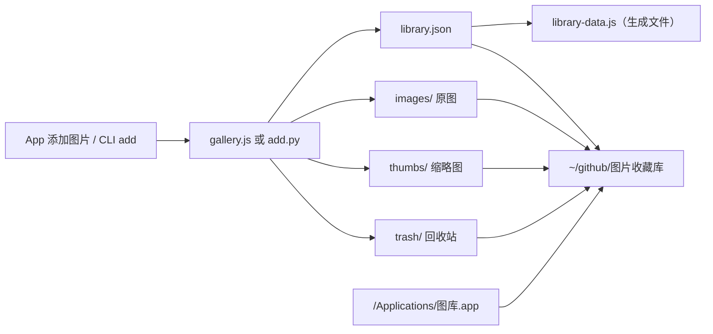

# 架构与数据流

## 总览

这是一个单机 Electron 应用，没有远程数据库或外部 API。图片和元数据都位于本机项目目录 `~/github/图片收藏库`；打包后的 App 只是启动器和界面载体。

## 代码分工

| 文件 | 责任 |
|---|---|
| `gallery.js` | Electron 主进程；读写数据、生成缩略图和主色、移动回收站文件、处理备份/拼贴导出 |
| `preload.js` | 在 `contextIsolation` 下暴露白名单 IPC 方法，不把 Node 能力直接交给页面 |
| `index.html` / `style.css` / `app.js` | 页面结构、样式和交互；启动时从主进程读取最新数据 |
| `add.py` | 不打开 App 也能入库、删除、恢复、列出和重建数据 |
| `postbuild.js` | 把 Electron Packager 的临时目录整理成 `release/图库.app` |

## 运行时路径

`gallery.js` 根据运行方式选择数据根目录：

- 开发模式：使用源码目录 `__dirname`。
- 打包模式：使用固定的 `~/github/图片收藏库`（按当前用户的主目录拼出来）。

如果项目搬到其他路径，需要同步修改 `gallery.js` 的 `PROJECT_DIR`，再重新打包；否则 `/Applications/图库.app` 仍会指向旧目录。

## 数据模型

`library.json` 顶层主要字段如下：

- `version`：数据结构版本，目前为 `1`，不要把它当成 App 版本。
- `categories`：由图片分类汇总生成。
- `collections`：合集定义；图片通过 `images[*].collections` 保存合集 ID。
- `trash`：回收站条目，包含原图片快照、原图/缩略图在 `trash/` 下的路径和移入时间。
- `images`：图片元数据，包括 `id`、`num`、`file`、`thumb`、`title`、`category`、`tags`、`colors`、`favorite`、`desc` 和 `added`。

`library-data.js` 由 `gallery.js` 或 `add.py` 在保存时重写，供静态页面和 Electron 共用。它不是编辑入口。

## IPC 边界

页面只能通过 `preload.js` 调用这些能力：

- 读取：`get-library`
- 版本更新：`get-changelog`（读取 `docs/CHANGES.md`）
- 图片：`add-images`、`update-image`、`batch-update-images`
- 回收站：`remove-image`、`remove-images`、`restore-image`、`empty-trash`
- 合集：`create-collection`、`rename-collection`、`delete-collection`
- 输出：`save-collage`、`create-backup`
- 系统：`open-in-finder`

主进程在处理文件路径时使用 `safeResolve` 限制在项目根目录内。删除先移动到 `trash/`；只有清空回收站才会真正删除文件。
